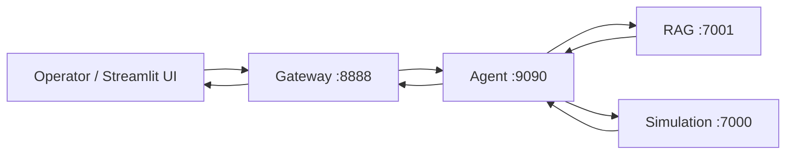

# TelcoMind — AI-Native Digital Twin Copilot with Intent-Driven Self-Healing

TelcoMind is an AI-native operations copilot for telecom networks. It lets an operator
ask natural-language questions and receive citation-grounded, evidence-backed diagnoses
that combine standards/runbook knowledge with fresh Simu5G experiments or recorded telemetry —
delivered through a single-node, one-click Docker Compose stack.

`./deploy.sh` now selects the live simulation stack. Open the Streamlit UI and ask
for a baseline simulation to see job progress, measured KPIs and charts, cited
diagnosis, and downloadable run artifacts. Pure standards questions use RAG
without starting a simulation. See [the live workflow](DOCs/live-workflow.md)
and [traffic burst, resource comparison, and mobility scenarios](DOCs/live-scenarios.md).

`./deploy.sh --opea` selects the real OPEA agent for evidence-grounded reasoning
with OpenAI, while retaining the existing simulation job workflow. It requires
private model credentials and makes paid inference requests during verification.
See [OPEA configuration and verification](DOCs/opea-integration.md).

## Overview and Business Problem

Telecom operations teams face high cognitive load: correlating live/replayed KPIs with
3GPP/O-RAN standards, internal runbooks, and prior incidents is slow and error-prone.
TelcoMind reduces mean-time-to-understanding by turning an operator intent (for example
"diagnose degraded handover on this cell") into a grounded diagnosis that cites the exact
knowledge sources and the simulation evidence it used, while being explicit about what it
did and did not do.

## Main Capabilities

- **Operator natural-language interface** — a Streamlit UI for asking operational questions.
- **Gateway and Agent orchestration** — a public Gateway API that proxies to an Agent that
  classifies intent and orchestrates tool calls.
- **Standards/runbook-grounded RAG** — retrieval over a curated quickstart knowledge base
  (runbooks and scenario/spec excerpts).
- **Recorded telecom simulation replay** — deterministic replay of a recorded phase fixture
  with explicit provenance, not a newly executed live simulation.
- **Fresh seven-cell baseline simulation** — isolated Simu5G runs with requested UE
  counts and seeds, measured application telemetry, progress, and cancellation.
- **Traffic, resource, and mobility experiments** — bounded traffic bursts,
  same-seed resource-band comparisons, and moving UEs with recorded serving-cell transitions.
- **Citation-grounded deterministic synthesis** — answers are assembled deterministically
  from retrieved chunks with explicit citation IDs.
- **Explicit dependency and unsupported-scenario failure behavior** — the system surfaces
  honest errors (for example unsupported replay faults, malformed requests, and unreachable
  dependencies) instead of fabricating results.
- **Meaningful end-to-end scenarios** — a runnable catalog of real Gateway→Agent→RAG/Simulation
  scenarios with structural and provenance assertions.
- **Single-node Docker Compose deployment** — five services brought up with one command.

## Architecture



## Truthful Quickstart Defaults

The explicit replay quickstart (`./deploy.sh --replay`) is intentionally lightweight and reproducible:

- **Recorded replay**, not a newly executed Simu5G run.
- **Lexical BM25 retrieval**, not semantic/vector retrieval.
- **Deterministic synthesis**, not an LLM (`llm_used=false`).
- **CPU-only**; **no GPU required**.
- **No Tailscale required**.
- Optional advanced modes (live Simu5G, semantic RAG, vLLM synthesis) are **not part of the
  default quickstart** and are environment-dependent.

## Prerequisites

- **Git**
- **Docker Desktop** or **Docker Engine** with **Compose v2**
- **Recommended 4 CPU cores**
- **Recommended ~8 GB RAM** available to Docker (the quickstart stack is CPU/light-memory
  oriented; deterministic defaults avoid model memory pressure)
- **GPU optional and unnecessary** for the quickstart

## One-Click Deployment

PowerShell:

```powershell
.\deploy.ps1
```

Bash:

```bash
./deploy.sh
```

Direct Compose:

```bash
docker compose -f docker-compose.yml -f docker-compose.live.yml up -d --build
```

For the lightweight recorded demo, run `./deploy.sh --replay` or
`.\deploy.ps1 -Replay`. The first live build downloads and compiles the simulator;
it can take longer than ten minutes. Subsequent runs reuse compiled Docker layers.
The root deployment reads the repository-root `.env`, not `CODE/.env`.

## Services

| Service | Port |
| --- | --- |
| Simulation | 7000 |
| RAG | 7001 |
| Gateway | 8888 |
| Agent | 9090 |
| UI | 8501 |

## URLs and Health Checks

- UI: http://localhost:8501
- Gateway: http://localhost:8888 — health: http://localhost:8888/v1/health
- Agent: http://localhost:9090 — health: http://localhost:9090/v1/health_check
- RAG: http://localhost:7001 — health: http://localhost:7001/health
- Simulation: http://localhost:7000 — health: http://localhost:7000/health, ready: http://localhost:7000/ready

## Demo Instructions

1. Open the Streamlit UI at http://localhost:8501.
2. Run a meaningful diagnosis (for example ask to diagnose a degraded handover / bootstrap phase).
3. Inspect the **citations** returned with the answer.
4. Inspect the **replay provenance** (fixture id, mode) attached to the simulation evidence.
5. Run the scenario suite against the live Gateway:

   ```bash
   python scripts/run_demo_scenarios.py
   ```

6. **Failure-injection mode** (separate, optional) stops and restarts dependencies to prove
   honest failure and recovery behavior:

   ```bash
   python scripts/run_demo_scenarios.py --with-failure-injection
   ```

## Testing

```powershell
.\test.ps1
```

```bash
./test.sh
```

```bash
python scripts/run_demo_scenarios.py
```

## Expected Outcomes

- All five services report healthy.
- The offline test matrix passes in isolation.
- The meaningful E2E scenarios pass (8/8) with grounded citations and replay provenance.
- Unsupported/malformed requests return honest error statuses rather than fabricated answers.
- Failure injection demonstrates dependency-failure handling and recovery.

## Evidence

The following are verified from this repository during Batch 9 validation:

- Five-service healthy Compose deployment.
- Successful host-side smoke test.
- Successful isolated offline test matrix (Batch 9).
- 8/8 Batch 9 meaningful E2E scenarios passing.
- Successful failure injection and service recovery.
- Approximately **33-second cached development-machine deployment**.

> **Note:** The ~33s figure is **cached development-machine evidence**, not a universal or
> clean-machine guarantee. Cold-build and formal four-core constrained timings are not
> formally established here.

## Known Limitations

- Default simulation is **recorded replay** (not a live Simu5G execution).
- **Full semantic RAG** is optional and not the quickstart default.
- **Live Simu5G** is optional and environment-dependent.
- **vLLM** synthesis is optional and not used by default.
- No claim of **real-network corrective action** — the system diagnoses; it does not execute
  telecom changes.
- No formal **OPEA certification** claim.
- No formal **clean-machine four-core timing** claim beyond what repository evidence proves.

## Documentation

- [Deployment](DOCs/DEPLOYMENT.md)
- [Testing](DOCs/TESTING.md)
- [Service Contracts](DOCs/SERVICE_CONTRACTS.md)
- [RAG Profiles](DOCs/RAG_PROFILES.md)
- [Simulation Modes](DOCs/SIMULATION_MODES.md)
- [LLM Backends](DOCs/LLM_BACKENDS.md)
- [Demo Scenarios](DOCs/DEMO_SCENARIOS.md)
- [Performance Evidence](DOCs/PERFORMANCE_EVIDENCE.md)

## Technical Report

- [TECHNICAL_REPORT.md](TECHNICAL_REPORT.md) (PDF export: [TECHNICAL_REPORT.pdf](TECHNICAL_REPORT.pdf) when generated)

## License and Third-Party Notices

- [LICENSE](LICENSE) — Apache License 2.0
- [THIRD_PARTY_NOTICES.md](THIRD_PARTY_NOTICES.md)

## Demo Video

**Demo video folder:** https://drive.google.com/drive/folders/1HTGxiuk3dk1el6hzPPlSq3WNEocslcdc?usp=drive_link
